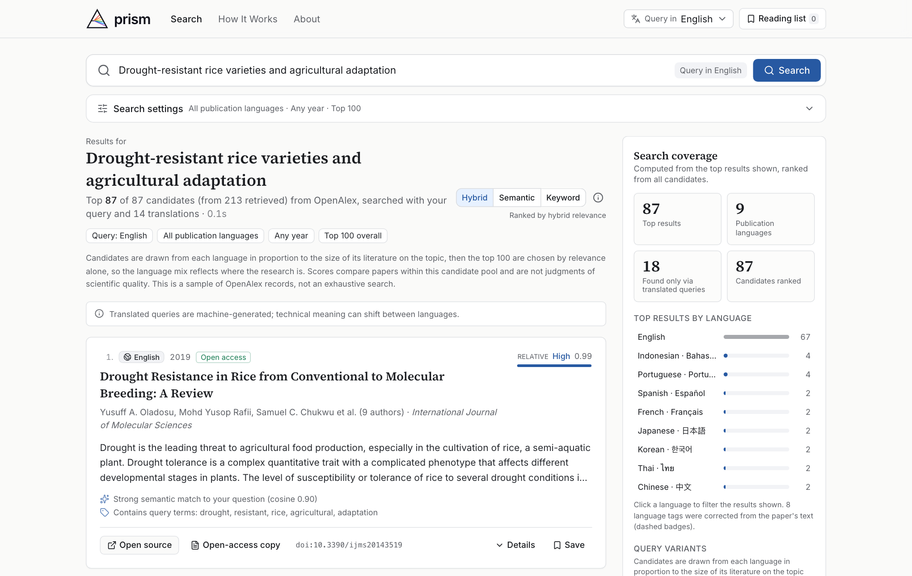

<p align="center">
  <picture>
    <source media="(prefers-color-scheme: dark)" srcset="docs/prism-logo-dark.svg">
    
  </picture>
</p>

<p align="center"><strong>One question. Every language.</strong></p>

<p align="center">
  A multilingual research search engine that finds the scientific papers your language might otherwise cause you to miss.
</p>



## Why Prism

Science is published in many languages, but most literature discovery happens through English queries. A question about drought and rice yields misses papers that describe the same experiments as 干旱胁迫 and 水稻产量, or sequía and rendimiento del arroz. Translation tools help you read what you have already found. Prism helps you find it in the first place.

## What it does

- **Ask in any of 15 languages:** English, Chinese, Spanish, Portuguese, French, German, Japanese, Russian, Korean, Indonesian, Italian, Turkish, Polish, Ukrainian and Arabic.
- **Search all of them at once.** Gemini turns your question into keyword queries in every language, and each query searches [OpenAlex](https://openalex.org) for papers published in that language.
- **Rank across languages.** Results are scored with multilingual embeddings and language-aware BM25 keyword matching, and the 100 most relevant are shown, whatever their language.
- **Show its work.** Each result explains why it matched: semantic similarity, matched terms, and which language's query found it. A coverage panel shows the language mix and every query that ran.
- **Fix wrong language tags.** OpenAlex detects languages automatically and sometimes mislabels papers, such as Chinese-tagged papers with English abstracts. Prism flags papers whose text disagrees with their tag (unless the title is in the tagged language, since many journals add English abstracts), and Gemini checks them. Confirmed corrections show as a dashed badge that names the original tag.
- **Keep originals first.** Titles and abstracts can be machine-translated into your language; translations are always labeled and shown next to the original. Optional AI summaries use only the abstract and say what it doesn't state.
- **Use real data only.** Every result is a live OpenAlex record. Missing abstracts, DOIs and languages are shown as missing, never filled in.

Also included: Hybrid / Semantic / Keyword ranking modes, filters for publication language, year and minimum relevance, a comparison against an original-language-only search, and a reading list stored in your browser.

## Quick start

```bash
npm install
cp .env.example .env.local   # add GEMINI_API_KEY and OPENALEX_API_KEY (see below)
npm run dev                  # http://localhost:3000
```

On first start the server downloads the multilingual embedding model (~120 MB) into `.cache/models` in the background. Until it is ready, searches use keyword ranking and say so.

### Configuration

Every variable is optional, and the app tells you when a feature is off.

| Feature | Without configuration | Enable with |
| --- | --- | --- |
| Paper search (OpenAlex) | Works, but all keyless users on your network share about 100 searches a day | `OPENALEX_API_KEY`: free, ~1,000 a day ([get one](https://openalex.org/settings/api)) |
| Searching in 15 languages | **Off.** Only your original question is searched | `GEMINI_API_KEY` ([get one](https://aistudio.google.com/apikey)) |
| Translated titles, abstracts and summaries | **Off.** The controls explain why | `GEMINI_API_KEY` |
| Multilingual semantic ranking | Works (local model, no key) | On by default; `EMBEDDINGS_ENABLED=false` turns it off |
| Crossref as a supplementary source | Off | `CROSSREF_ENABLED=true` |

Gemini tasks default to `gemini-3.8-flash`. If a model is overloaded or rate limited, Prism falls back through `LLM_FALLBACK_MODELS` (default `gemini-3.6-flash,gemini-3.5-flash-lite`) and labels translations and summaries with the model that produced them.

A search makes roughly 16–30 OpenAlex requests: one per language, one to size each language's literature, and a few broader retries for sparse languages. With a free key that is about 40–60 Prism searches a day. Selecting fewer publication languages uses fewer, and responses are cached for 24 hours.

## How it works

1. **Expand.** Gemini rewrites the question as 2–5 key concepts in each language, most essential first, plus the main subject term (asthma, 哮喘, asma …). Your original question is always searched too.
2. **Retrieve.** Each language's query searches OpenAlex titles and abstracts, restricted to papers in that language. A query that finds fewer than five papers is broadened by dropping its least essential concepts, never by splitting a phrase.
3. **Size each literature.** One OpenAlex request counts each language's papers on the subject. Candidates are kept from each language in proportion to that count, with at least two per language. This is how federated search engines merge collections of different sizes.
4. **Score.** Every candidate is scored against the question in all its languages:
   - **Semantic:** cosine similarity from `paraphrase-multilingual-MiniLM-L12-v2`, run locally with Transformers.js.
   - **Keyword:** BM25 over ICU-segmented text, so Chinese and Japanese are split into words.
   - **Hybrid (default):** 70% semantic plus 30% keyword. These weights are tunable starting values, not validated constants.
5. **Explain.** The top results are shown with explanations built only from computed scores and retrieval facts.

### How ranking stays fair across languages

Testing showed several ways a multilingual ranker can quietly favour one language. Each one is addressed:

| Problem | Fix |
| --- | --- |
| Equal candidates per language oversample small literatures. For "Shakespeare", English has ~79,000 papers and Italian ~1,100 | Candidates are drawn in proportion to each language's literature on the topic |
| In a mostly-English pool, other languages' words look rare, which inflates their BM25 scores | Each query's score is divided by its own maximum, putting every language on the same 0–1 scale |
| Short title-only records look like dense keyword matches | Length is normalized separately for title-only and title-plus-abstract records |
| Abstracts dilute embedding similarity, which favours papers without one | Each paper is scored on the better of its title alone and title plus abstract |
| A broadened query is easier to match than the full question | Keyword scoring always uses every concept, even when the search was broadened |
| One language's phrasing of the question skews similarity | The question is embedded in every language and averaged |

Results for "Shakespeare", for example, come out about 71% English, close to English's share of that literature. A topic with a large Chinese literature still surfaces Chinese papers.

Cross-language similarity check (`npm run check:embeddings`) against "How does drought stress affect rice crop yields?". These are seven sentences, not a benchmark:

| Text | Cosine |
| --- | --- |
| English paraphrase | 0.95 |
| Chinese translation | 0.86 |
| Portuguese translation | 0.83 |
| Spanish translation | 0.83 |
| Japanese translation | 0.71 |
| Unrelated topics | ~0 |

## Development

```bash
npm run dev               # development server
npm run build && npm start
npm run lint
npm run typecheck
npm test                  # unit tests (mocked APIs, no network)
npm run test:e2e          # Playwright, desktop and mobile (mocked API)
npm run test:live         # real OpenAlex + local model (uses API budget)
npm run check:embeddings  # cross-language similarity check
```

Built with Next.js 16, TypeScript, Tailwind CSS, shadcn/ui, Transformers.js and the Google Gen AI SDK.

```
app/            pages (/, /how-it-works, /about) and API routes
  api/search      validate → expand → retrieve → allocate → score → JSON
  api/translate   batch title and abstract translation (cached)
  api/summarize   abstract-only structured summary
  api/status      capability flags (LLM, embedding model, keys present)
components/     UI (SearchExperience, PaperCard, SearchCoverage, Logo, …)
lib/            retrieval, ranking, translation and shared types; no UI code
tests/unit      Vitest suites
tests/live      opt-in live checks against OpenAlex
e2e/            Playwright workflow tests
docs/           logo and screenshot used in this README
```

## Limitations

- **Coverage:** Prism searches OpenAlex only. Regional journals, theses and non-DOI literature are underrepresented, and each language contributes at most 100 candidates, so results are a sample, not an exhaustive search.
- **Language corrections:** these judge the title and abstract, not the full text. A paper whose title and abstract are both in another language than its tag is relabeled. Without a Gemini key, OpenAlex's tags are used as they are.
- **Literature sizes:** these are estimates from OpenAlex counts for a machine-translated subject term.
- **Missing abstracts:** many records have none, most often Japanese ones. Those are ranked on their titles and labeled.
- **Translation drift:** machine-translated queries can shift technical meaning. Every query is shown in the coverage panel.
- **Speed:** a fresh search scores up to ~1,500 candidates on the CPU and takes about 5–20 seconds. Repeats are cached.
- **Not fully language-neutral:** ranking is multilingual but not perfectly language-neutral. Note the lower Japanese similarity above.
- **Storage:** caches are in memory and reset on restart. The reading list lives in your browser's `localStorage`.

## Data and credits

Paper metadata comes from [OpenAlex](https://openalex.org) (CC0). The embedding model is [paraphrase-multilingual-MiniLM-L12-v2](https://huggingface.co/sentence-transformers/paraphrase-multilingual-MiniLM-L12-v2) from sentence-transformers. Query expansion, translation and summaries use the [Gemini API](https://ai.google.dev).
